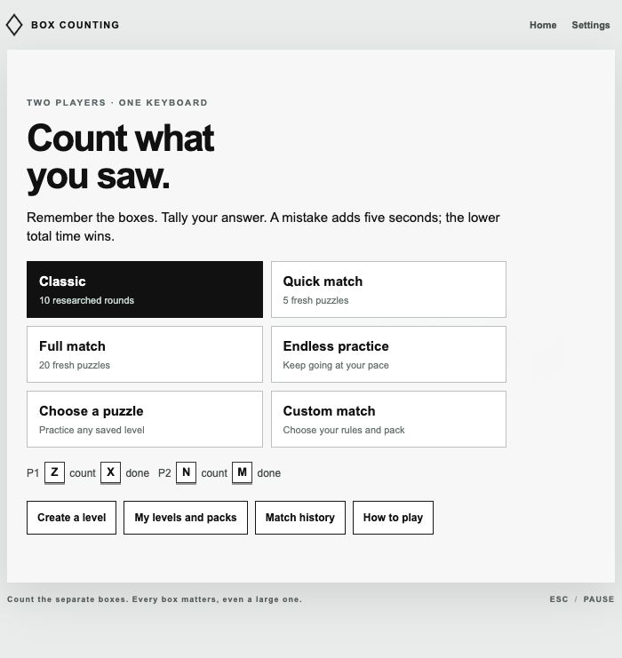
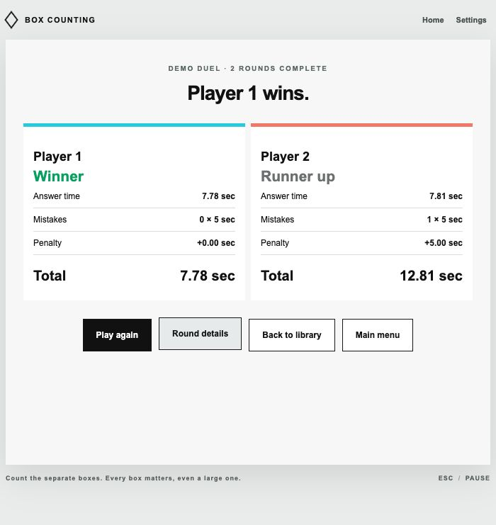

# Release QA

Checked 13 October 2026. This supplements the earlier prototype checks and records the expanded local game's verification.

## Automated checks

`node --test tests/*.test.mjs` passes **51 tests**. The suite checks the ten reference counts, the large-box/entity distinction, rotations and depth-preserving mirrors, the footage's 29.24 versus 53.34 scoring result, displayed-centisecond draws, a version-locked generator fixture, deterministic distinct packs, and 1,440 generated layouts across all sixteen families and three presets.

Engine checks cover countdown/preview input rejection, independent locks and timers, single settlement, deadlines, correct counters without submission still timing out, fresh generated replacements after pausing, settled-reveal recovery, Endless generation/finish, and a complete twenty-round match. Data checks cover unsupported/overlapping geometry, duplicate IDs, bounded sizes, normalized JSON round trips, rendering bounds, persisted packs, key conflicts, storage write failures, malformed history/drafts, and replayable saved geometry.

The Python schema/semantic checker also passes for the reference pack. Playable JSON copies match the development fixtures. All shipped JavaScript modules pass Node's syntax check. The server serves only `dist`, not research downloads or browser metadata.

## Browser checks

Tested in the Codex in-app browser on this computer. Independent stable Firefox and Safari runs were not performed; the in-app browser does not expose a browser version in the QA control interface.

| Flow | Observed result |
| --- | --- |
| Menu | All ten modes, library, editor, history, settings, and instructions are reachable. |
| Authored editor | A 2×2×1 cuboid is one box/four occupied cells; stacking a unit produces two boxes/five cells. Undo and redo restore the correct object count. |
| Editor test | Submitted two for that arrangement; solo results show one correct answer, 100% accuracy, and an independent answer time. Returning retains the editor. |
| Saving and exchange | Saved a named level, exported JSON, imported it as a new pack, and preserved the original level. |
| Pack authoring | Built a two-level pack, reordered it, saved it, reloaded the page, and saw the correct pack and order retained. |
| Controls | Duplicate N binding rejected; custom Q accepted; restored and saved default Z/X/N/M controls. |
| Timed Custom | An authored pack played both levels despite generated round count being set to one. Two unanswered deadlines produce 10.00s answer time plus 10.00s penalties per player, yielding a 20.00s draw. |
| Two-player saved pack | P1 submitted the correct answers 3 and 2. P2 submitted 4 and 2. P1 won at 7.78s; P2 had 7.81s answer time plus one 5s mistake, totaling 12.81s. |
| Endless | Played and submitted two generated tower rounds, then Finish practice retained exactly those two rounds. |
| Quick/pause | Started a five-round generated solo session, paused after counting one, resumed through a fresh countdown, and observed a reset 00 counter. Leaving returned to the menu without recording a winner. |
| History/replay | Completed sessions persisted across reload; answers/results remained intact. Replay opened the correct saved pack's keyboard check. |
| Responsive menu | At 360×800, document width equals viewport width (360px), stage width is 344px, and every menu action remains visible without horizontal overflow. Restored normal viewport afterward. |
| Results layout | Solo and two-player results fit the normal viewport; narrow solo results use a vertical stat layout. |
| Browser errors | No console errors reported after the final flows. |

Earlier prototype QA completed all ten reference rounds in the browser and checked large-box/tower reveals, repeat suppression, ignored pre-answer input, independent submissions, and mirrored authored pause behavior. That historical record remains valid for the unchanged reference content; the expanded engine also has dedicated automated coverage.

## Evidence

## Practical limits

Actual keyboard rollover depends on the keyboard and was not tested with two humans or a second physical keyboard. No hardware-level input/display latency, frame-rate benchmark, or independent browser matrix is claimed. The generated families have geometry checks and constrained placements; custom authored puzzles still need a visual fairness check. The original game's exact fonts, audio, paths, timing, rare tie/overflow rules, and full unpublished level library are not recovered.

This release completes local play, multiple modes, authoring, JSON exchange, saved libraries, history/replay, remapping, and optional audio/motion/contrast settings. Online play, accounts, leaderboards, gamepads, adaptive progression, and richer editor timeline/path controls remain extensions.

## Video, duel, and motion expansion

The expanded suite adds source-layout checks, deterministic progressive/motion campaigns, minimum-round lead rules, point correctness/ties, cap draws, automatic termination after reveal, deadline scoring, pause without phantom points, long-duel history retention, stable travel geometry, and a bounded linear fallback. Follow-up browser QA verified automatic victory under both lead rules, invalid-cap rejection, five-box promotional practice, and paused/fixed-HUD motion. [Detailed evidence](10-video-layouts-and-endless-duel.md) includes the actual screenshots and motion samples.

## Phone controls

Added automatic phone detection, keyboard-free touch checks, persistent side controls, solo left/right controls, viewport/safe-area layouts, and a saved input-mode override. The five additional tests cover portrait/landscape detection, held/multiple contacts, ignored previews and independent locks, touch-only readiness, and setting compatibility. [Phone QA](11-phone-controls.md) records the completed pointer-only match, solo result, and viewport measurements.

The latest expansion adds a batch Puzzle generator, six-factor 0–100 puzzle ratings, saved-level tier filtering, and a customizable ten-tier Difficulty Climb. See [generator, scoring, and verification](12-puzzle-generator-and-difficulty.md).

Every playable box now requires a fully unobstructed face. Hidden layouts cannot be imported, saved or played; older saved copies stay available for repair or export. Native linear motion retains its board geometry during viewing. See [visibility and smooth motion](13-visibility-and-smooth-motion.md).
