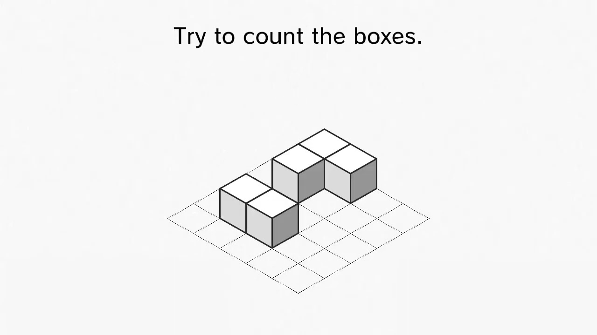
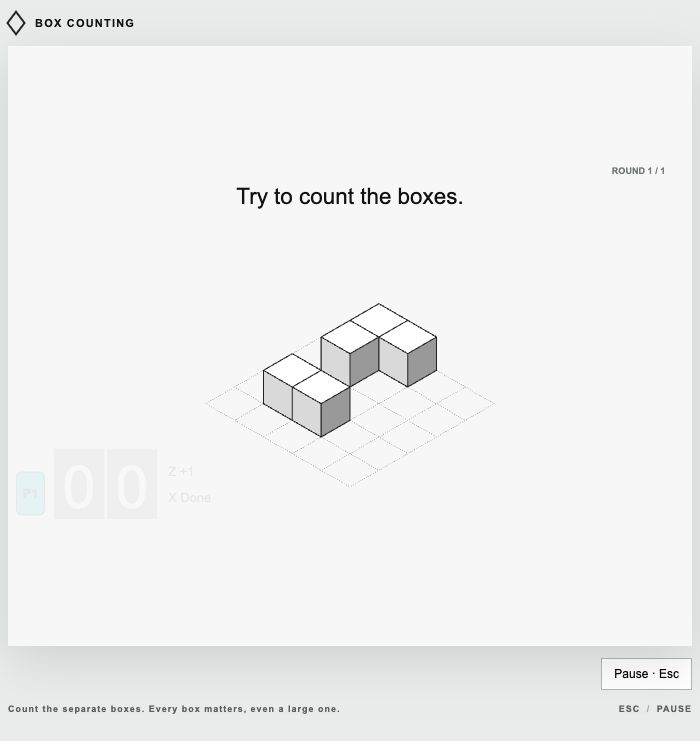
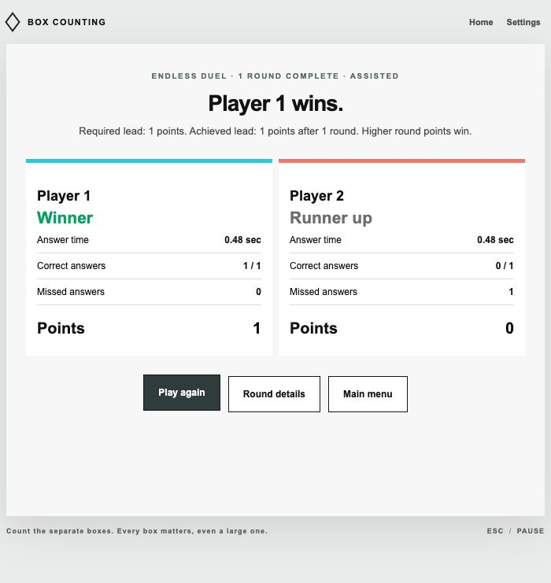
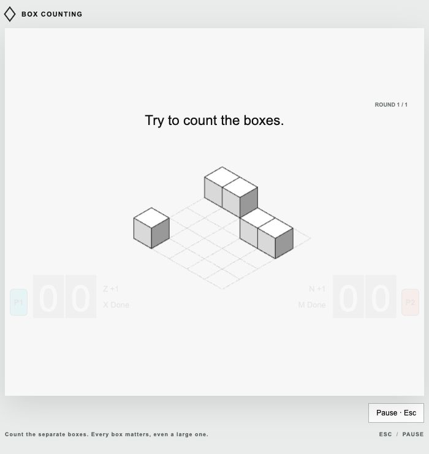

# Video layouts, unusual patterns, endless duels, and smooth motion

Implemented 13 October 2026. [Play locally](http://127.0.0.1:8765/) or see [all instructions](08-playable-prototype.md).

## What was re-examined

Re-sampled the full Hadski counting segment (321–399 seconds) at four frames per second and decoded selected Watch/Reveal frames at full resolution. Also re-sampled both Nintendo UK clips at four frames per second. The complete original videos remain downloaded locally; this was direct visual analysis of their decoded frames, not an inference from titles or transcripts.

The footage uses short stationary views, diagonal passes in different directions, short flashes, tall individual towers, broad unsegmented boxes, offset groups, and separate rows. A closer look at Hadski's fourth reveal showed a **gap** in the five-box formation: three consecutive boxes, a gap, and two offset foreground boxes. Several earlier approximate locations were corrected to the visible grid. No new official scoring rule was established; lead-based duels and progressive campaigns are browser extensions.

## The copied layouts

The playable [video pack](../data/video-pack.json) begins with the two promotional formations and then reproduces the ten Hadski layouts. [Classic's pack](../data/reference-pack.json) received the same coordinate corrections. The previous approximation is preserved at `references/original-reconstruction-pack.json`. Geometry is manually traced rather than extracted from Nintendo software; timing and travel endpoints remain approximations.

| Video / frame | Copied arrangement | Count | Notes |
| --- | --- | --- | --- |
| [Nintendo clip 1](https://www.youtube.com/watch?v=JfkkS7yH4Co), 2.3s | 2×2 group with a two-box tail | 6 | Reveal confirms six. |
| [Nintendo clip 2](https://www.youtube.com/watch?v=9PZazcFJEvk), 2.3s | Three-box back group and offset two-box front group | 5 | Five visible unit objects; the short clip does not include a numeric reveal. |
| [Hadski](https://www.youtube.com/watch?v=2SR6dQM1BDc), 324.0s | Same-column pair and separated singleton | 3 | Corrected the first pair's orientation and positions. |
| Hadski, 329.0s | Five-box group and singleton | 6 | Corrected the fifth connected box's cell. |
| Hadski, 336.1s | Two two-high towers and rear singleton | 5 | Towers are at opposite outer cells. |
| Hadski, 349.25s reveal | Gapped travelling line and offset pair | 5 | Corrected the continuous-row assumption. |
| Hadski, 351.95s | One broad 2×2 box, two touching units, and singleton | 4 | Occupied area is seven unit cells; answer remains four objects. |
| Hadski, 358.5s | Four-high left tower, two-high right tower, rear singleton | 7 | Corrected the right tower's position. |
| Hadski, 366.7s | Two rows of four | 8 | Both rows begin one cell over. |
| Hadski, 375.5s reveal | Three-box elbow after a short flash | 3 | Reveal supplies coordinates that a coarse Watch sample can miss. |
| Hadski, 381.9s reveal | Offset adjacent pairs after fast travel | 4 | Reconstructed from the centered reveal. |
| Hadski, 384.2s | Five-by-five board missing center | 24 | Existing count and geometry retained. |

Reference/video layouts now use a fixed SVG camera at the footage's approximate grid origin (640, 312), with 54/31.18/62.35 projection units. Custom/generated levels still fit their full bounds within the canvas. The source frames and source/copy comparisons make the reconstruction auditable; this is not a claim of exact original fonts, display latency, or easing.

`tools/revisit_videos.py` recreates thirteen full-resolution tracing frames from the downloaded MP4 files. Both playable packs pass the JSON Schema and semantic geometry tests.

## Four extra modes

| Mode | Behavior |
| --- | --- |
| Video Challenge | Twelve traced formations, solo or two players. Also available as a Custom source, in individual practice, and in the pack builder. |
| Pattern Ladder | Twenty generated rounds by default, configurable 1–50. Starts from the chosen difficulty and advances every five rounds. Early groups/rows lead to gaps, broad boxes, towers, stairs, hollow frames, checkerboards, dense boards, and flashes. |
| Motion Gauntlet | Ten generated rounds by default, configurable 1–50. Every puzzle travels, combining groups, gaps, rows, towers, and large boxes. Paths remain straight and continuous in varied diagonal directions. Difficulty advances every five rounds. |
| Endless Duel | Two players play generated puzzles until a configurable lead is reached after the minimum rounds. An optional cap ends close games. |

The gapped, row, broad-box, tower, and flash families directly follow observed structures. Hollow frames, checkerboards, varied stair heights, and travelling combinations extend those structures for replayability. Their provenance records generator v2 and their family. These are clearly described as browser extensions rather than additional recovered Nintendo levels. Advanced families join mixed games after round five; a single family can also be selected in Endless practice or Endless Duel.

## Endless Duel: exact stopping and winning rules

Default settings: **20-second adjusted-time lead**, **minimum 5 completed rounds**, **15-second answer deadline**, **no round cap**, **Gentle starting difficulty**, and **difficulty rises every five rounds**.

Under the time rule, accumulated answer time plus five seconds per mistake is compared to centisecond resolution. Lower is better. Only after both answers settle does the engine check whether the absolute lead meets the chosen threshold and the minimum rounds have been completed. The final green reveal completes before the match ends.

Under the optional point rule, one correct answer beats one wrong/missing answer and earns one point. If both are correct, the faster answer to the displayed hundredth of a second earns one point. Both wrong or tied correct times award no points. Higher accumulated points win. This rule does not apply time penalties to its winner calculation or result/details UI.

Controls expose time lead (1–120 seconds), point lead (1–20), minimum rounds (1–50), cap (0–500), answer limit or unlimited waiting, family, seed, starting difficulty, escalation, and viewing-time override. Only the threshold matching the selected rule is used. A nonzero cap must be at least the minimum rounds. At the cap, the current score decides the winner or draw. Pausing voids an unfinished attempt without awarding a point; abandoning a duel does not declare a winner. Long duel history preserves cumulative totals/points while retaining the latest fifty detailed rounds for replay.

## Movement change and verification

Previously, each travel frame rebuilt the whole SVG, re-created every face/grid/HUD node, and used another clock read during rendering. The new `GameScene` caches the Watch markup and retains the Watch scene and asks the browser to animate only its parent transform through one linear Web Animation. It sets the animation clock once at entry, keeps fractional coordinates, and cancels it when the phase changes. The animation freezes on pause. A fallback updates only the parent's transform if Web Animations is unavailable. Frame rendering and engine updates share one timestamp.

The renderer never resizes or sorts geometry based on how much of the board is currently onscreen. The board and grid move together; the HUD remains outside the moving layer. Reveal restores the centered arrangement.

Browser samples during a five-second moving exposure showed identical SVG geometry across all samples and these continuous translations in canonical pixels:

| Sample | X | Y |
| --- | --- | --- |
| 1 | 196.984 | −88.6428 |
| 2 | 30.024 | −13.5108 |
| 3 | −183.136 | 82.4112 |

The direction stays consistent and follows the same straight diagonal. Sampling intervals include screenshot/tool overhead and are not a frame-rate benchmark. A separate paused check found an unchanged transform across 350ms. A final browser pass with the geometry cache enabled also kept moving-tower SVG markup unchanged while its transform advanced from (153.494, −69.0723) to (−13.426, 6.0417). A renderer regression test drives 120 updates and verifies **one geometry mount, one animation start, and no repeated cancellation**, followed by correct pause/cancel behavior. A second regression test verifies that 120 Watch frames call the geometry renderer only once, and invalidate the cache for a changed puzzle or contrast setting. This removes the per-frame DOM churn identified in our renderer; hardware or browser scheduling can still affect perceived smoothness.

## QA

All **32 tests pass**, including 1,440 generated layouts across sixteen families and three difficulties. New tests cover copied counts/gaps/towers, versioned deterministic campaigns, minimum rounds, adjusted-time leads, correctness-based points and ties, cap draws, automatic finish after reveal, timeout scoring, pause without phantom points, long-duel persistence, retained travel nodes, and bounded linear fallback motion.

Browser QA completed one-round lead victories under both rules, rejected a cap below the minimum rounds, played the five-box promo copy to a 100% solo result, verified continuous travel/static geometry/fixed HUD and paused motion, and checked the new mode setup controls. Browser checks also launched Video Challenge and confirmed ROUND 1 / 12 with the six-box promotional copy; Pattern Ladder exposed its default twenty-round setup. The campaigns share the tested match engine. Screenshots above are actual browser captures. Independent Firefox/Safari and physical-keyboard rollover checks remain outside this local QA run.
