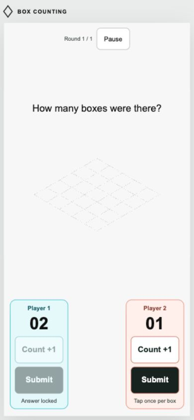
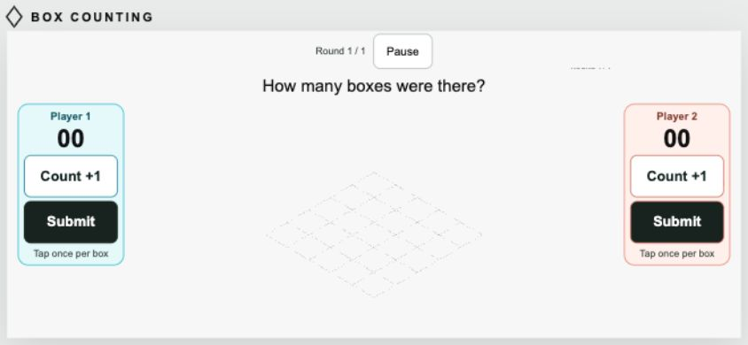
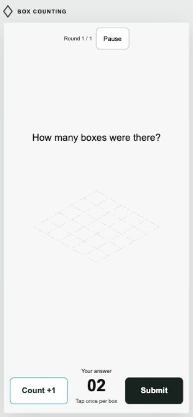

# Phone controls

Added 13 October 2026. The same game modes and scoring work with touch or keyboard input.

## Automatic behavior

Phone-sized portrait windows automatically enable touch controls. A coarse pointer or touch-capable device with a short screen edge up to 700 CSS pixels also enables them in landscape. Window and input-device changes update the layout. Settings → Game controls provides Automatic, Touch buttons on any device, and Keyboard/desktop overrides; the choice is saved. Existing saved settings default to Automatic.

The initial control check shows tappable Count and Submit buttons instead of requiring physical keys. Two-player modes check both players' pairs; solo checks only Player 1. Keyboard bindings remain available when a keyboard is connected.

During a two-player game, **Player 1 has Count +1 and Submit on the left; Player 2 has their own pair on the right**. Large answer counters and lock/feedback labels accompany each pair. Solo play puts Count on the left and Submit on the right, with one shared answer display. Pause remains accessible at the top, along with the current round and optional answer deadline. Endless solo practice also has Finish practice.

Buttons are disabled during countdown/Watch and after that player's submission. Each contact adds only one; holding does not repeat. Each player's locks and times remain independent. Correct/incorrect feedback appears only after the reveal. Pointer cancellation, blur, and leaving a screen release tracked contacts.

The pads stay mounted across count changes to avoid interrupting another player's finger or replacing buttons between rapid taps. Pointer-down handles the action; the compatibility click does not count again. Keyboard/assistive activation uses the button's click path. Control updates do not replace or reanimate the moving board.

## Layout

Portrait uses bottom-left and bottom-right pads, with a larger board view above them. Landscape moves the pads to the screen edges and reserves the center for the board. The game fills the dynamic viewport, accounts for safe-area insets, and reserves space for a duel scoreboard. Keyboard HUD badges are replaced by the touch pads. Menus/forms remain scrollable; gameplay buttons suppress selection, long-press menus, and touch scrolling on the buttons themselves.







## Verification

All **37 tests pass**. The added tests cover phone detection in both orientations, overrides, simultaneous independent contacts and repeated contact rejection, preview input rejection, independent player locks and reveal feedback, keyboard-free readiness, and saved-setting compatibility.

Browser testing used a 390×844 portrait viewport and an 844×390 landscape viewport. Portrait automatically selected touch mode. A two-player one-level match completed entirely through on-screen buttons: each two-tap counter read 02; Player 1 locked while Player 2 continued; both received Correct feedback. Results preserved independent times (28.49s and 29.52s) with no mistakes. A solo reference puzzle also completed with three taps and a 100% result. Landscape used the Touch override to exercise layout in the desktop test browser, which does not emulate a physical phone's coarse pointer. Its document measured exactly 844×390, with no page overflow.

These are viewport and pointer-input checks in the in-app browser, not physical iPhone/Android or multi-finger hardware tests. The contact-tracking unit test covers multiple pointer IDs. Automatic mode was restored after testing.

## Open the local preview on a real phone

A phone needs a game URL reachable from that device. The default `127.0.0.1` preview is local to the computer. For a same-Wi-Fi preview, start an additional server explicitly:

```sh
python3 tools/serve_game.py --host 0.0.0.0 --port 8766
```

Open `http://<your-computer's-local-IP>:8766/` on the phone. The server serves only `dist`, and Control-C stops it. The existing default preview remains bound to loopback; adding the command option did not open a new network listener during this task. A hosted copy can use the same `dist` files.
