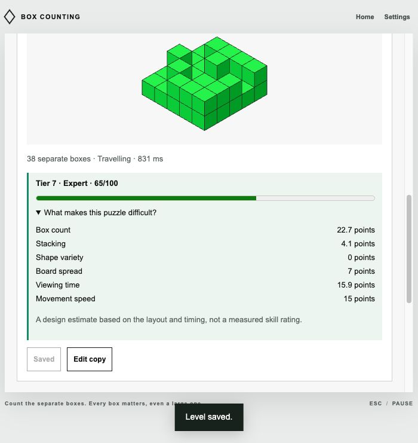
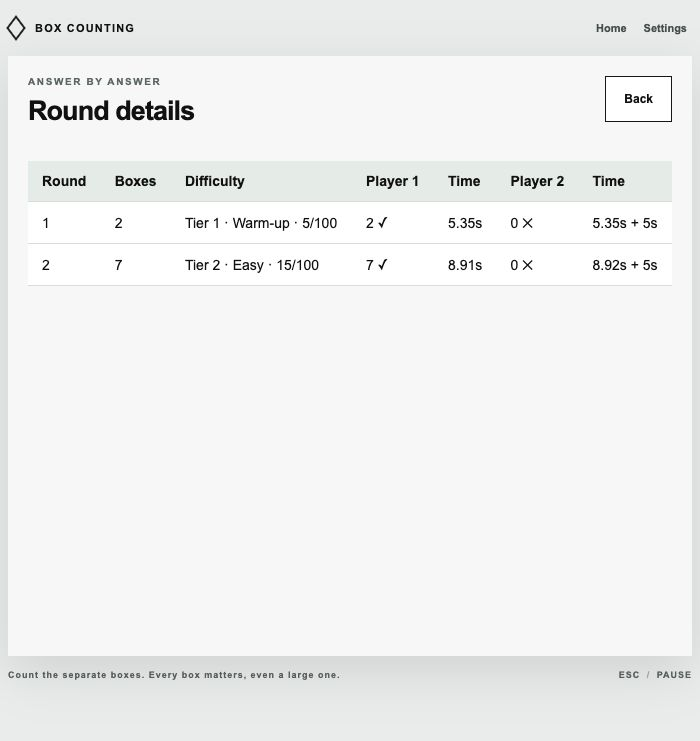
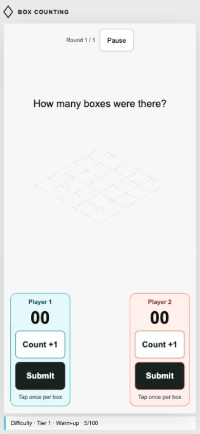

# Puzzle generator and Difficulty Climb

The main menu now includes **Puzzle generator** and **Difficulty Climb**. These are browser extensions to the researched game, not claimed Nintendo modes or Nintendo difficulty ratings. The original seeded generator v2 and Classic layouts remain unchanged.

## Generate, inspect, keep, and play

1. Open Puzzle generator. Choose a target tier (1–10), batch size (1–50), one of sixteen shape styles or a mix, and automatic, stationary, or travelling presentation.
2. Enter a seed or choose New seed. Generate puzzles. The same seed and settings reproduce the batch; pressing Generate again reproduces it. New seed preserves the controls and changes the seed.
3. Every card previews its geometry, separate box count, presentation, exposure, actual difficulty tier and 0–100 score. Expand the scoring breakdown for its six contributions. The requested tier is a target; a restricted style or stationary presentation may not reach it.
4. Save individual levels, save the batch as a pack, edit a copy, export JSON, or play the batch solo or with two players. Existing level and pack capacity limits still apply. Saving the same displayed level or pack again does not add duplicates.
5. My levels and packs displays calculated ratings and filters saved levels by tier. Edit an existing level's geometry or timing to change its rating, then save it to retain the change. Pack builder shows individual level ratings.

Generation produces supported, collision-free boxes on the existing five-by-five board with a maximum height of four. It starts from the existing formations, trims uppermost boxes first when necessary, and adds legal ground boxes and supported tower segments for higher counts. Automatic presentation permits travel and introduces it consistently at high targets. Duration fitting chooses the closest rating supported by the geometry and presentation. Rated generator version 2 has its own seed namespace so previous v2 seeds are unchanged.

## Difficulty score v2

This is a transparent game-design estimate, not a calibrated prediction of player performance. It does not change match points, time penalties, or correct answers. A broad box still counts as one object.

| Factor | Maximum contribution | What raises it |
| --- | ---: | --- |
| Separate box count | 30 | `(boxCount - 1) / 18`, clamped to 0–1 |
| Stacking and height | 12 | `(maximumTopHeight - 1) / 6 + raisedBoxFraction × 0.5`, clamped |
| Shape variety | 8 | 0.5 when a non-unit box exists, plus 0.25 per additional width/depth/height combination, clamped |
| Board spread | 10 | 40% from center spread, 30% from disconnected ground groups, 30% from occupied ground area |
| Exposure | 25 | Logarithmic increase as duration falls from 5000 ms to 100 ms stationary or 300 ms travelling |
| Movement speed | 15 | Euclidean travel distance per second divided by 2200, clamped |

Spread uses the diagonal span between extreme box centers, normalized by `sqrt(32)`. Disconnected groups use four-neighbor adjacency of occupied ground footprints and saturate at five groups. Ground area saturates at 25 cells. Exposure is `log(5000 / durationMs) / log(5000 / minimumDurationMs)`, clamped to 0–1. Timing therefore reflects the actual presentation, rather than a style name.

The final score is the rounded sum of unrounded contributions, clamped to 0–100. The visible factor values are rounded to tenths and can differ slightly from the rounded final sum. Tiers are 0–9 → 1, 10–19 → 2, through 80–89 → 9 and 90–100 → 10. Their labels are Warm-up, Easy, Tricky, Moderate, Challenging, Hard, Expert, Extreme, Master, and Maximum.

Scores are recalculated from geometry and timing, including for saved levels, imports, and history details. Imported claimed scores are not trusted or stored. The version 1 pack format stays compatible; JSON geometry and timing are sufficient to reproduce the rating. Replacing movement with a stationary view changes the actual rating and marks play as assisted.

## Difficulty Climb mode

Choose solo or two players, 1–50 rounds, starting tier, maximum tier, number of tiers added per rise, rounds per rise, shape style, presentation, and seed.

The requested tier for zero-based round `i` is:

```text
min(maximumTier, startingTier + floor(i / roundsPerRise) × tierStep)
```

The default is twenty rounds, beginning at tier 1, increasing one tier every two rounds, and finishing at tier 10. A faster ramp can increase several tiers every round. When the maximum is reached, remaining rounds continue there with new layouts. Each round displays its actual tier and score; Round details and saved history retain the rating through the recorded geometry. Restrictive style choices can limit actual difficulty even while the requested target rises.

Two-player scoring remains accumulated answer time plus five seconds for each mistake; lower adjusted time wins. Solo play reports accuracy and average time. Each player locks independently. Keyboard and phone touch controls both work. Pausing an unfinished generated round replaces it at the same requested tier; finished rounds retain their scores. Play again makes a fresh batch with the same ramp settings and a new seed.

## Verification

- 51 automated checks pass. Six new checks cover the score factors, reproducibility, all ten actual tiers across eight seeds, 96 combinations of styles/presentation/target, configurable ramps, distinct layouts, import and saved-rating consistency, complete two-player play, pause replacement, and reduced motion.
- Browser generation: generated two tier-7 puzzles (65/100 each), saved one level and the batch pack, filtered the level library by tier, and verified both survived reload.
- Editor check: increased a saved travelling level’s duration from 831 ms to 2550 ms; its rating dropped from tier 7 (65/100) to tier 5 (46/100). Undo restored the original rating and saved level.
- Browser match: completed a two-player climb from tier 1 (5/100, two boxes) to tier 2 (15/100, seven boxes). Player 1 answered both correctly; Player 2's two mistakes added ten seconds. Round details showed the ratings and correct counts.
- Phone-sized viewport: generated a one-level batch with no horizontal page overflow, then completed a touch-only two-player climb using the on-screen checks, count and submit buttons. The difficulty bar stayed visible. This was a browser viewport check, not physical-phone hardware testing.
- Existing motion tests still verify mounted geometry, linear parent movement and pause freezing.








The generator now enforces a fully unobstructed face for every box, with a readable travel path. Rated generator v2 and difficulty score v2 replace the initial high-count approach; old saved geometry is preserved for repair. Count points saturate at nineteen visible boxes so high tiers do not need hidden interiors. See [the visibility rule and motion verification](13-visibility-and-smooth-motion.md). The browser results listed above describe the original generator rollout; the linked visibility report records the latest release.
