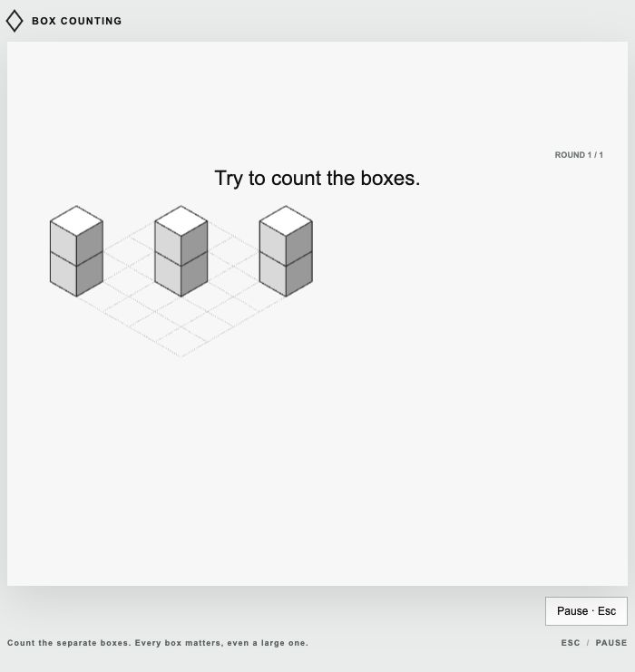
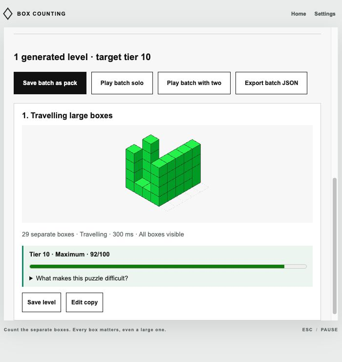
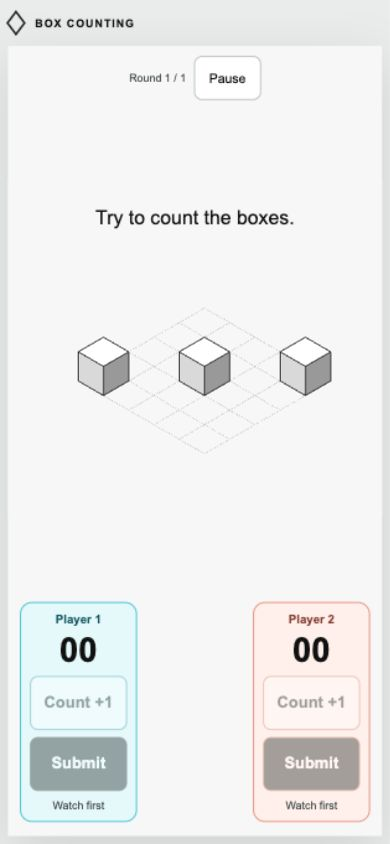

# Visible boxes and smooth motion

Every playable box must have at least one complete, unobstructed camera-facing face. Adjacent boxes can share boundaries and towers can cover each other's unused faces, but a sliver, implied support, or entirely hidden object is never sufficient. This is a hard rule for all modes, new imports, editor saves and play tests, generated batches, and the engine itself.

## Visibility validation

`dist/geometry.js` supplies the same projection, face polygons and paint order to the renderer and validator. It derives back-to-front dependencies from overlapping projected cuboids and their separated world-coordinate axes. Ambiguous cyclic ordering is rejected. It checks each box's three camera-facing polygons against all later boxes using convex polygon intersections. Touching edges have zero overlap area and are allowed; at least one whole face must remain clear.

The common desktop/phone canvas rectangle is x=240–1040, y=145–645 in the game's coordinate system. Static boxes must fit inside it. For travel, validation analytically intersects the full-box bounds with the viewport along the entire linear path. Each complete box must be inside the readable region for at least 80 ms. Paths that never show a box, or skim it too quickly, are rejected. A shortened viewing-time override is raised to the necessary minimum rather than bypassing this rule.

All ten Classic levels and all twelve Video Challenge entries pass. Their researched geometry and object counts remain unchanged. The original generator v2 also passes the rule with its existing seed fixture unchanged.

Rated generator v2 checks visibility after every proposed addition. Extra boxes are accepted only when they preserve a full clear face for every existing box as well. High targets can use exposed tall columns and mixed-size segments, rather than interiors concealed behind towers. Its automatic travelling presentations move horizontally. Difficulty score v2 saturates the count contribution at nineteen visible objects, instead of rewarding the much larger obscured arrangements produced by the previous rated generator. All ten target tiers remain reachable with mixed automatic generation.

Previously saved obscured layouts and history are retained. The library marks affected levels and packs as needing a visibility fix and disables play. They remain editable and exportable. New imports and saves must pass the rule; recorded results do not become playable merely because they were saved by an earlier version.

## Motion rendering

The moving board is mounted once per viewing phase. A single native browser animation translates its parent with `translate3d` and linear easing. The geometry, object order, grid, and individual boxes stay fixed relative to one another. It does not round movement to whole pixels or rebuild polygons each frame.

Initial animation time is aligned with the game clock. Pause freezes the animation. A required redraw, such as changing contrast, recreates the animation at the elapsed position instead of restarting at the entrance. The fallback also updates only the parent transform with the same linear path. Preview HUD elements no longer sit over the board. Repeated unchanged header, phase, and visibility writes were removed. Phone play uses the stable small viewport height so browser-bar changes do not continually resize the game canvas.

## Verification

The full suite has **51 passing tests**. Eight fairness regressions cover:

- A small box hidden behind a broad four-high tower is rejected by validation, import and the engine.
- Shared boundaries remain valid; actual polygon-area overlap is detected.
- Tower bases paint before their tops regardless of box IDs, with visible faces for each segment.
- Authored packs, generator families, all numeric tiers and travel exposures pass the visibility rule.
- Missed viewport paths, edge skims and oversized boxes travelling too quickly are rejected.
- Older unfair libraries, drafts and results survive loading without enabling play.
- Moving geometry stays mounted across irregular frame times; redraws keep elapsed alignment and preview HUDs cannot cover it.
- A short viewing override cannot bypass minimum travel exposure.

A phone-sized 390×844 viewport also showed all three moving boxes at the center of the preview, with touch controls outside the board and no page overflow. This was viewport testing, not physical-phone hardware testing.

Browser checks preserved the older 38-box generated level and its pack while disabling their play controls. A newly generated tier-10 board passed with 29 visible objects and a 92/100 difficulty rating.

A live six-box travelling tower formation was sampled 60 times over 1589 ms. Geometry and box count were unchanged in all samples. Motion never reversed. The diagonal path differed from its expected x/y relationship by at most 0.0006 pixels; position differed from the linear wall-clock fit by at most 3.337 game-coordinate pixels, within normal frame sampling quantization at 400 pixels/second. See [the measurements](../output/motion-frame-check.json). This was an in-app browser check, not a claim about every physical device's frame rate.

